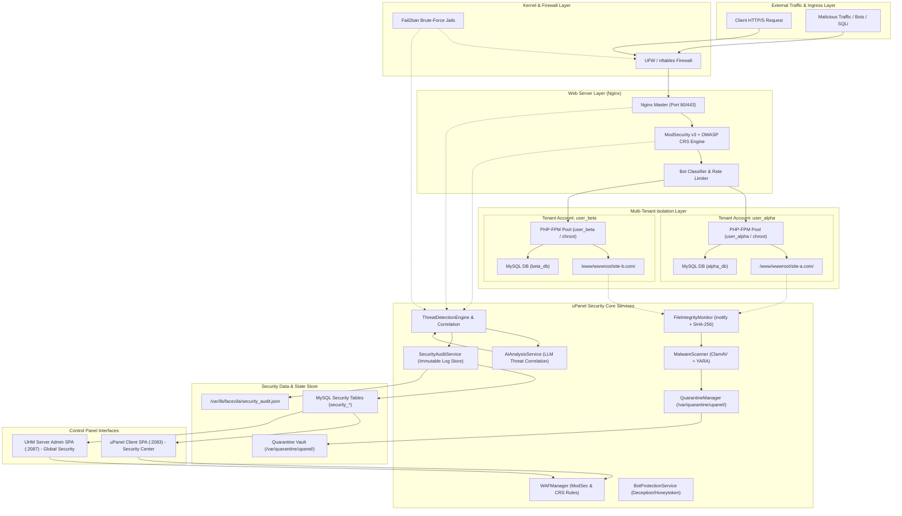
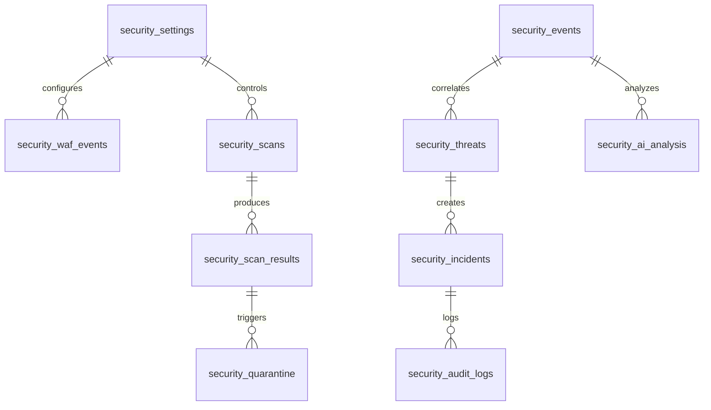

# uPanel AI Cyber Security & Advanced Hosting Protection — System Architecture
**Document ID:** `UPANEL_SECURITY_ARCHITECTURE.md`  
**Date:** November 2026  
**Version:** 1.0.0-PROD  
**Author:** Antigravity AI Systems Architecture Team  
**Target Platform:** UltraOnePanel (uPanel / UHM) on Linux (Ubuntu 22.04 / 24.04 LTS)

---

## 1. Architectural Mission & Scope

The purpose of this architecture is to integrate a complete, enterprise-grade **AI Cyber Security & Threat Protection Module** directly into the existing **UltraOnePanel (uPanel / UHM)** hosting platform without disrupting any existing services (Nginx, Multi-PHP FPM, MySQL/phpMyAdmin, DNS, SSL, FTP, Mail, or Server Management).

### Core Architectural Guarantees:
1. **Zero-Breakage Hosting Principle**: No existing website configurations, virtual host routings, databases, or client files are modified during module installation.
2. **Rule-First, AI-Augmented**: Protection operates deterministically via kernel, web server, and signature layers (UFW, ModSecurity v3, ClamAV, inotify, Fail2ban). AI acts as an asynchronous analytical and threat-correlation engine; it does not replace core deterministic security and does **not** have direct arbitrary root execution privileges.
3. **Multi-Tenant Isolation**: Complete isolation between hosting accounts at the Linux OS level (UID/GID), filesystem level, PHP-FPM execution pool level, and database access level.
4. **Safe, Non-Destructive Quarantine**: Suspicious files are never permanently deleted automatically. Files confirmed malicious are atomically moved to a hardened, non-executable, out-of-docroot quarantine vault with full cryptographic checksums and one-click rollback restoration.
5. **Fail-Safe Rollback Engine**: Any WAF, firewall, or isolation rule change maintains an automatic fallback and syntax-validation pipeline to guarantee administrators are never locked out and websites never go offline due to a syntax error.

---

## 2. High-Level System Architecture Diagram



---

## 3. Submodule Architectural Breakdown (14 Modules)

### Module 1: Security Overview Dashboard
* **Purpose**: Single-pane-of-glass situational awareness for administrators (global) and website owners (per-tenant).
* **Key Metrics**:
  * Server Security Health Score (calculated algorithmically, $0-100\%$, based on concrete benchmarks: firewall status, WAF coverage, pending malware alerts, FIM status, backup freshness, and open ports).
  * Real-time attack feed (WAF blocks, brute-force bans, bot challenges).
  * 24-Hour / 7-Day threat trend distribution (SQLi, XSS, RCE, Bad Bots, Unauthorized Logins).
  * Per-website protection status table (Active WAF, FIM status, last scan time, quarantine count).
* **Data Sources**: Aggregated dynamically from `security_events`, `security_scans`, `security_quarantine`, and UFW/Fail2ban status APIs.

---

### Module 2: AI Threat Intelligence & Real-Time Anomaly Detection
* **Purpose**: Correlates disparate event streams to detect advanced multi-stage attacks (e.g., scan $\rightarrow$ credential spray $\rightarrow$ plugin vulnerability exploit $\rightarrow$ web shell drop).
* **Architecture & Telemetry Pipeline**:
  * Collects logs asynchronously from Nginx (`/www/wwwlogs/*.log`), ModSecurity audit log (`/var/log/modsec_audit.log`), Auth log (`/var/log/auth.log`), and FIM events.
  * Ingestion queue: Token-bucket rate-limited buffer to prevent log-flooding attacks.
  * Event normalizer formats raw logs into unified JSON schema:
    ```json
    { "timestamp": "ISO8601", "source_ip": "1.2.3.4", "domain": "example.com", "event_type": "WAF_BLOCK", "severity": "HIGH", "raw_payload": "..." }
    ```
* **AI Analysis Engine**:
  * Pluggable provider architecture: Supports local heuristic analyzer (zero external dependencies) and external LLM provider (OpenAI / Gemini / Anthropic API via secure proxy).
  * **Strict Prompt-Injection Defense**:
    * Log payloads and website code are treated strictly as **untrusted data payloads** and passed in delimited, non-executable JSON schemas.
    * Output is constrained to strict JSON schema with pre-defined enum values (`threat_level`: `INFO|LOW|MEDIUM|HIGH|CRITICAL`, `attack_category`, `confidence_score: 0.0-1.0`, `suggested_action`).
  * **Safety Isolation**: AI engine has **zero command-line shell execution capability**. All suggested actions are queued as recommendations requiring administrator or rule-engine confirmation.

---

### Module 3: Web Application Firewall (WAF)
* **Engine**: **ModSecurity v3 (libmodsecurity)** compiled with Nginx connector (`modsecurity-nginx`), backed by the **OWASP ModSecurity Core Rule Set (CRS v3.3+)**.
* **Protection Scope**:
  * SQL Injection (SQLi), Cross-Site Scripting (XSS), Remote Code Execution (RCE), Local/Remote File Inclusion (LFI/RFI), Path Traversal, PHP Object Injection, HTTP protocol abuse, and known zero-day CVE patterns.
* **Operational Modes**:
  1. `DetectionOnly` (Passive monitoring, logs anomalies without breaking legitimate user requests).
  2. `On` (Active blocking with custom branded 403 Forbidden template).
* **Per-Domain Configuration**:
  * Main configuration: `/etc/nginx/modsec/modsecurity.conf` and `/etc/nginx/modsec/crs-setup.conf`.
  * Per-domain override file: `/www/server/panel/vhost/nginx/modsec/{domain}.conf` loaded via virtual host `include`. Allows per-site rule exclusions (e.g., excluding false positives for WordPress REST API or WooCommerce checkout).
* **Safe Reloading**:
  * Automated pre-reload validation via `nginx -t`. If validation fails, configuration immediately rolls back to previous known-good backup snapshot and notifies administrator.

---

### Module 4: Malware Scanner
* **Engines**: Multi-tiered hybrid scanning pipeline:
  1. **Tier 1 (Fast Signature)**: **ClamAV Daemon (`clamd`)** connected via local UNIX socket `/run/clamav/clamd.ctl` for virus, trojan, and known web shell signatures.
  2. **Tier 2 (Heuristic Pattern)**: **YARA Rules Engine** compiled with specialized web-shell, crypto-miner, and backdoor rule packages (e.g., Neo23x0 / Thor signatures).
  3. **Tier 3 (PHP Behavioral)**: Custom PHP AST analyzer detecting high-entropy variable names, dynamic function invokes (`$a($b)`), nested `base64_decode` + `gzinflate` + `eval`, unauthorized `system`/`exec`/`passthru` calls.
* **Scan Scopes**:
  * On-demand full server scan, per-website scan, or single directory scan.
  * Real-time scan triggered on file upload (via upload hook or FIM trigger).
  * Scheduled cron scans during low-traffic off-peak hours (e.g., 03:00 AM).
* **Performance Controls**:
  * `nice -n 19` and `ionice -c 3` CPU/IO priority throttling to ensure web server performance is never degraded.
  * File size limits (skip scanning binaries $> 50\text{ MB}$, stream-scan archives up to $20\text{ MB}$).
  * Scan exclusion lists: Cache directories (`/cache/`, `/wp-content/cache/`), temporary files (`/tmp/`), and clean backups (`.tar.gz`).

---

### Module 5: File Integrity Monitoring (FIM)
* **Mechanism**: Linux **`inotify`** kernel event subsystem (via Node.js `chokidar` or dedicated inotify C-daemon) watching `/www/wwwroot/{domain}/`.
* **Baseline Engine**:
  * Maintains cryptographic baseline database: `SHA-256` hash, permissions (`mode`), UID/GID, and modification timestamp (`mtime`) for every file.
  * Specialized CMS Core Baselines: For WordPress and Joomla sites, compares core files against official clean repository checksums to eliminate false positives during legitimate updates.
* **Monitored Events**:
  * Creation of `.php`, `.phtml`, `.sh`, `.py`, `.pl`, `.cgi`, or hidden `.*` files in non-executable directories (e.g., `/wp-content/uploads/`).
  * Unauthorized modifications to sensitive root files (`.htaccess`, `wp-config.php`, `index.php`).
  * Critical permission escalations (e.g., changing file to `0777` or adding SUID bit).

---

### Module 6: Safe Quarantine & Restoration Engine
* **Storage Location**: Dedicated isolated directory `/var/quarantine/upanel/`.
* **Security Attributes**:
  * Filesystem isolation: Mode `0700`, owned by `root:root`.
  * Prohibited execution: Quarantined files are stripped of executable bits (`chmod 0000`) and stored with randomized UUID filenames (e.g., `550e8400-e29b-41d4-a716-446655440000.quar`).
  * Completely outside web server docroot (`/www/wwwroot/`) and inaccessible via any HTTP/HTTPS virtual host.
* **Metadata & Forensic Manifest**:
  * Every quarantined item creates an immutable JSON manifest:
    ```json
    {
      "quarantine_id": "quar_88291410",
      "timestamp": "2026-11-24T00:15:00Z",
      "domain": "example.com",
      "account_user": "web_example",
      "original_path": "/www/wwwroot/example.com/wp-content/uploads/shell.php",
      "sha256": "e3b0c44298fc1c149afbf4c8996fb92427ae41e4649b934ca495991b7852b855",
      "size_bytes": 14208,
      "original_permissions": "0644",
      "original_owner": "www:www",
      "detected_by": "YARA:PHP_Anuna_Webshell",
      "confidence": 0.98
    }
    ```
* **One-Click Restoration Workflow**:
  * Admin/user clicks "Restore File" $\rightarrow$ System verifies ownership $\rightarrow$ Atomic move back to original path $\rightarrow$ Restores original permissions and ownership $\rightarrow$ Writes security audit log entry.
  * Permanent Purge: Secure multi-pass unlink (`shred` or zero-overwrite) after admin confirmation.

---

### Module 7: Advanced Bot Protection & Deception Security
* **Classification Pipeline**:
  1. **Good Bots**: Automated allowlist based on reverse-DNS and ASN validation (Googlebot, Bingbot, DuckDuckBot, UptimeRobot, Let's Encrypt ACME).
  2. **Bad Bots**: Fingerprints known automated vulnerability scanners (Nikto, SQLmap, Acunetix, ZGrab, curl/python user-agents).
  3. **Suspicious / Scrapers**: High-frequency request patterns ($> 60\text{ req/min}$ to dynamic endpoints).
* **Challenge & Rate Limiting**:
  * Transparent JavaScript cryptographic PoW (Proof of Work) challenge before allowing access to login pages or search queries.
* **Honeypot / Deception Engine**:
  * Injects synthetic, non-functional decoy endpoints (e.g., `/admin/wp-login-fake.php`, `/.env.backup`, `/phpmyadmin_fake/`).
  * Any IP probing these decoy URLs is flagged as an active malicious scanner and instantly jailed across all virtual hosts.

---

### Module 8: Login Security & Brute-Force Defense
* **Target Vectors**: uPanel (:2083), UHM (:2087), SSH (:22), FTP (:21), phpMyAdmin, and WordPress `wp-login.php`.
* **Protection Mechanisms**:
  * Progressive delay & lockouts: 5 failed attempts in 10 minutes triggers a 1-hour IP block via Fail2ban / iptables.
  * Two-Factor Authentication (2FA): Native RFC 6238 TOTP authentication for all panel users with backup emergency recovery codes.
  * Dynamic GeoIP filtering: Option to restrict administrative logins to specific countries or specific static IP ranges.
  * Active session invalidation on credential change or privilege escalation.

---

### Module 9: IP Management & Country-Level Firewall
* **Backend**: **UFW** (Uncomplicated Firewall) with direct netfilter/nftables hook.
* **Capabilities**:
  * Global Whitelist & Blacklist (supports single IPv4/IPv6 and CIDR subnets e.g. `192.168.1.0/24`).
  * Temporary vs. Permanent Bans (with automatic expiration timers managed by `SecurityScheduler`).
  * Country-level GeoIP blocking powered by local **MaxMind GeoLite2 Country database** (`/var/lib/facezila/geoip/GeoLite2-Country.mmdb`).
  * **Admin Lockout Prevention Protocol**:
    * Current admin IP address is automatically whitelisted during any bulk firewall update.
    * Port 22 (SSH), Port 2083 (uPanel), and Port 2087 (UHM) are hardcoded as protected ports that cannot be removed by UI misconfiguration.

---

### Module 10: Multi-Tenant Website & PHP Isolation
* **Operating System Isolation**:
  * Every hosting account is bound to a dedicated non-privileged Linux user and group (`web_{user}:{user}`).
  * Website document root is locked to `0750` permissions (`drwxr-x--- web_{user} www-data`), preventing other Linux users on the server from traversing or reading files.
* **PHP-FPM Pool Isolation**:
  * Each domain runs its own dedicated PHP-FPM worker pool configuration (`/etc/php/{ver}/fpm/pool.d/{domain}.conf`).
  * `user = web_{user}`, `group = web_{user}`.
  * `open_basedir = /www/wwwroot/{domain}:/tmp:/var/tmp` restricts PHP file reads strictly to that website's directory.
  * `disable_functions` blocklist: `exec,passthru,shell_exec,system,proc_open,popen,curl_multi_exec,parse_ini_file,show_source`.
  * Private `/tmp` directory via systemd namespace (`PrivateTmp=yes`) prevents cross-site temporary file snooping.

---

### Module 11: Database Security & SQL Injection Defense
* **Least-Privilege Principle**:
  * Database users are provisioned with grants strictly scoped to their assigned database (`GRANT ALL PRIVILEGES ON db_user.* TO 'db_user'@'localhost'`). No cross-database read permissions.
  * Global privileges (`FILE`, `SUPER`, `PROCESS`, `SHUTDOWN`, `RELOAD`) are strictly revoked.
* **Connection Security**:
  * MySQL daemon binds strictly to `127.0.0.1:3306` (or UNIX socket `/var/run/mysqld/mysqld.sock`).
  * External remote MySQL access is disabled by default and only permitted via explicit IP whitelist.
* **Automated Configuration Audit**:
  * Daily audit verifies `local_infile = 0` (prevents arbitrary file reading via SQL injection) and `skip_symbolic_links = 1`.

---

### Module 12: Immutable Security Audit Logs
* **Architecture**: Tamper-evident, append-only event ledger stored in `/var/lib/facezila/security_audit.json` and mirrored in the `security_audit_logs` MySQL table.
* **Captured Fields**:
  * `event_id`: Unique cryptographic UUID.
  * `timestamp`: High-resolution ISO8601 UTC string.
  * `actor`: `{ type: "admin" | "user" | "system" | "ai", id: "username", ip: "1.2.3.4" }`.
  * `action`: Action verb (`quarantine_file`, `restore_file`, `block_ip`, `update_waf_rule`, `isolate_site`).
  * `target`: Affected resource (`example.com`, `192.168.1.100`, `/wp-config.php`).
  * `status`: `SUCCESS | FAILED | BLOCKED`.
  * `integrity_hash`: SHA-256 HMAC chained to the previous log record, ensuring log tampering is mathematically detectable.

---

### Module 13: Automated Incident Reports & Notifications
* **Alert Delivery Channels**:
  * In-Panel Real-Time Toast Notifications & Notification Center drawer.
  * SMTP Email alerts (via uPanel's existing `email.service.js`).
  * Telegram Bot Webhook (instant mobile push notifications for CRITICAL events).
  * Generic Webhook (JSON payload to Slack, Discord, or external SIEM).
* **Automated PDF / HTML Reports**:
  * Weekly & Monthly executive security summaries detailing total attacks blocked, malware incidents quarantined, and server hardening score progression.

---

### Module 14: Global & Per-Site Security Settings
* **Configuration Granularity**:
  * Global Admin Settings: Master switches for WAF engine, ClamAV daemon, FIM watchers, and AI correlation.
  * Per-Website Customer Settings: Customer can toggle WAF mode (`Detection` vs `Blocking`), trigger manual scans, manage legitimate IP whitelists, and view quarantined files.
* **Storage**: Atomic JSON store at `/var/lib/facezila/security_settings.json` synchronized with `security_settings` database table.

---

## 4. Database Schema Design

The security module introduces 12 relational tables into MySQL/MariaDB (with matching atomic JSON persistence fallbacks in `/var/lib/facezila/`).



### Table Specifications:

```sql
-- 1. Security Settings (Global & Per-Site)
CREATE TABLE IF NOT EXISTS `security_settings` (
  `id` INT AUTO_INCREMENT PRIMARY KEY,
  `scope` ENUM('global', 'site') NOT NULL DEFAULT 'global',
  `domain` VARCHAR(255) NULL,
  `waf_enabled` TINYINT(1) DEFAULT 1,
  `waf_mode` ENUM('detection', 'blocking') DEFAULT 'detection',
  `clamav_enabled` TINYINT(1) DEFAULT 1,
  `fim_enabled` TINYINT(1) DEFAULT 1,
  `ai_enabled` TINYINT(1) DEFAULT 0,
  `ai_provider` VARCHAR(50) DEFAULT 'local',
  `ai_api_key_enc` TEXT NULL,
  `bot_protection_level` ENUM('low', 'medium', 'high') DEFAULT 'medium',
  `quarantine_threshold` ENUM('high', 'critical', 'manual') DEFAULT 'high',
  `updated_at` TIMESTAMP DEFAULT CURRENT_TIMESTAMP ON UPDATE CURRENT_TIMESTAMP,
  UNIQUE KEY `uk_scope_domain` (`scope`, `domain`)
) ENGINE=InnoDB DEFAULT CHARSET=utf8mb4;

-- 2. Security Events Stream
CREATE TABLE IF NOT EXISTS `security_events` (
  `id` BIGINT AUTO_INCREMENT PRIMARY KEY,
  `domain` VARCHAR(255) NOT NULL,
  `source_ip` VARCHAR(45) NOT NULL,
  `event_type` VARCHAR(50) NOT NULL,
  `category` ENUM('SQLI', 'XSS', 'RCE', 'BRUTE_FORCE', 'MALWARE', 'BOT', 'ANOMALY') NOT NULL,
  `severity` ENUM('INFO', 'LOW', 'MEDIUM', 'HIGH', 'CRITICAL') NOT NULL,
  `request_uri` TEXT NULL,
  `raw_details` JSON NULL,
  `action_taken` ENUM('LOGGED', 'BLOCKED', 'CHALLENGED', 'QUARANTINED') NOT NULL,
  `created_at` TIMESTAMP DEFAULT CURRENT_TIMESTAMP,
  INDEX `idx_domain_created` (`domain`, `created_at`),
  INDEX `idx_severity` (`severity`),
  INDEX `idx_source_ip` (`source_ip`)
) ENGINE=InnoDB DEFAULT CHARSET=utf8mb4;

-- 3. Malware Scans
CREATE TABLE IF NOT EXISTS `security_scans` (
  `id` BIGINT AUTO_INCREMENT PRIMARY KEY,
  `scan_uuid` VARCHAR(64) NOT NULL UNIQUE,
  `domain` VARCHAR(255) NULL, -- NULL = Full Server Scan
  `target_path` VARCHAR(500) NOT NULL,
  `scan_type` ENUM('manual', 'scheduled', 'upload', 'fim') NOT NULL,
  `status` ENUM('queued', 'running', 'completed', 'failed', 'cancelled') DEFAULT 'queued',
  `files_scanned` INT DEFAULT 0,
  `threats_found` INT DEFAULT 0,
  `started_at` TIMESTAMP NULL,
  `completed_at` TIMESTAMP NULL,
  `created_at` TIMESTAMP DEFAULT CURRENT_TIMESTAMP
) ENGINE=InnoDB DEFAULT CHARSET=utf8mb4;

-- 4. Scan Results (Infections Found)
CREATE TABLE IF NOT EXISTS `security_scan_results` (
  `id` BIGINT AUTO_INCREMENT PRIMARY KEY,
  `scan_id` BIGINT NOT NULL,
  `domain` VARCHAR(255) NOT NULL,
  `file_path` VARCHAR(1000) NOT NULL,
  `threat_name` VARCHAR(255) NOT NULL,
  `scanner_engine` ENUM('clamav', 'yara', 'heuristic', 'ai') NOT NULL,
  `confidence` DECIMAL(3,2) NOT NULL DEFAULT 1.00,
  `is_quarantined` TINYINT(1) DEFAULT 0,
  `created_at` TIMESTAMP DEFAULT CURRENT_TIMESTAMP,
  FOREIGN KEY (`scan_id`) REFERENCES `security_scans`(`id`) ON DELETE CASCADE
) ENGINE=InnoDB DEFAULT CHARSET=utf8mb4;

-- 5. Quarantine Vault Ledger
CREATE TABLE IF NOT EXISTS `security_quarantine` (
  `id` BIGINT AUTO_INCREMENT PRIMARY KEY,
  `quarantine_uuid` VARCHAR(64) NOT NULL UNIQUE,
  `domain` VARCHAR(255) NOT NULL,
  `account_user` VARCHAR(100) NOT NULL,
  `original_file_path` VARCHAR(1000) NOT NULL,
  `quarantine_file_path` VARCHAR(1000) NOT NULL,
  `sha256` CHAR(64) NOT NULL,
  `file_size` BIGINT NOT NULL,
  `original_permissions` VARCHAR(10) NOT NULL,
  `original_owner` VARCHAR(50) NOT NULL,
  `threat_name` VARCHAR(255) NOT NULL,
  `status` ENUM('quarantined', 'restored', 'deleted') DEFAULT 'quarantined',
  `created_at` TIMESTAMP DEFAULT CURRENT_TIMESTAMP,
  `actioned_at` TIMESTAMP NULL
) ENGINE=InnoDB DEFAULT CHARSET=utf8mb4;

-- 6. File Integrity Monitoring (FIM Baseline)
CREATE TABLE IF NOT EXISTS `security_file_baselines` (
  `id` BIGINT AUTO_INCREMENT PRIMARY KEY,
  `domain` VARCHAR(255) NOT NULL,
  `file_path` VARCHAR(1000) NOT NULL,
  `sha256` CHAR(64) NOT NULL,
  `permissions` VARCHAR(10) NOT NULL,
  `owner` VARCHAR(50) NOT NULL,
  `mtime` BIGINT NOT NULL,
  `last_verified_at` TIMESTAMP DEFAULT CURRENT_TIMESTAMP,
  UNIQUE KEY `uk_domain_file` (`domain`, `file_path`(255))
) ENGINE=InnoDB DEFAULT CHARSET=utf8mb4;

-- 7. Blocked & Allowed IPs
CREATE TABLE IF NOT EXISTS `security_ip_rules` (
  `id` INT AUTO_INCREMENT PRIMARY KEY,
  `ip_address` VARCHAR(50) NOT NULL UNIQUE,
  `type` ENUM('whitelist', 'blacklist') NOT NULL,
  `reason` VARCHAR(255) NOT NULL,
  `banned_by` VARCHAR(50) DEFAULT 'system',
  `expires_at` TIMESTAMP NULL, -- NULL = permanent
  `created_at` TIMESTAMP DEFAULT CURRENT_TIMESTAMP
) ENGINE=InnoDB DEFAULT CHARSET=utf8mb4;

-- 8. Immutable Audit Log
CREATE TABLE IF NOT EXISTS `security_audit_logs` (
  `id` BIGINT AUTO_INCREMENT PRIMARY KEY,
  `event_uuid` VARCHAR(64) NOT NULL UNIQUE,
  `actor_type` ENUM('admin', 'user', 'system', 'ai') NOT NULL,
  `actor_name` VARCHAR(100) NOT NULL,
  `actor_ip` VARCHAR(45) NULL,
  `action` VARCHAR(100) NOT NULL,
  `target` VARCHAR(500) NOT NULL,
  `details` JSON NULL,
  `result` ENUM('SUCCESS', 'FAILURE', 'DENIED') NOT NULL,
  `chain_hash` CHAR(64) NOT NULL,
  `created_at` TIMESTAMP DEFAULT CURRENT_TIMESTAMP
) ENGINE=InnoDB DEFAULT CHARSET=utf8mb4;
```

---

## 5. API Interface Specification (`/api/security/*`)

All endpoints require JWT Authentication header (`Authorization: Bearer <token>`) and are protected by `roleMiddleware` and `tenantSiteMiddleware`.

| HTTP Verb | Route Path | Description | Access Role |
|---|---|---|---|
| `GET` | `/api/security/overview` | Returns system-wide threat score, attack statistics, active bans, and service statuses. | Admin, Reseller |
| `GET` | `/api/security/site-overview/:domain` | Returns per-domain security metrics, scan status, and WAF events. | Website Owner, Admin |
| `GET` | `/api/security/waf/config` | Retrieves global and per-site ModSecurity configuration. | Admin |
| `POST` | `/api/security/waf/toggle` | Toggles WAF state (`detection` $\leftrightarrow$ `blocking` $\leftrightarrow$ `disabled`). | Admin |
| `GET` | `/api/security/waf/events` | Paginated query of ModSecurity blocked/logged requests. | Admin, Website Owner |
| `POST` | `/api/security/scanner/start` | Initiates on-demand malware scan (full server or per-site). | Admin, Website Owner |
| `GET` | `/api/security/scanner/status/:scanUuid` | Retrieves real-time progress and discovered threats. | Admin, Website Owner |
| `GET` | `/api/security/quarantine/list` | Lists all quarantined files with threat metadata and original docroot paths. | Admin, Website Owner |
| `POST` | `/api/security/quarantine/restore` | Safely restores a quarantined file to its original location. | Admin |
| `POST` | `/api/security/quarantine/delete` | Permanently shreds and deletes quarantined file. | Admin |
| `GET` | `/api/security/fim/changes` | Returns unauthorized file modification alerts detected by inotify. | Admin, Website Owner |
| `POST` | `/api/security/fim/baseline-rebuild` | Recalculates cryptographic SHA-256 baseline for a domain. | Admin |
| `GET` | `/api/security/ip-rules` | Returns active whitelist, blacklist, and Fail2ban jail bans. | Admin |
| `POST` | `/api/security/ip-rules/add` | Adds IP/CIDR to whitelist or permanent blacklist. | Admin |
| `DELETE` | `/api/security/ip-rules/:id` | Unbans or removes IP rule. | Admin |
| `POST` | `/api/security/site-isolate/:domain` | Toggles maintenance/lockdown mode for a compromised website. | Admin |
| `GET` | `/api/security/audit-logs` | Paginated immutable audit trail with actor and verification chain. | Admin |
| `POST` | `/api/security/ai/analyze` | Triggers LLM-assisted correlation on an incident ID or log slice. | Admin |

---

## 6. Security Guarantees & Operational Safety Bounds

1. **Non-Disruption of Production Hosting**:
   - Web server configurations are validated with `nginx -t` before any reload. If a syntax check fails, the candidate configuration is discarded and the existing active configuration remains untouched.
2. **AI Action Containment**:
   - The AI analysis engine has strictly read-only access to log buffers. It cannot invoke arbitrary bash scripts, modify user passwords, drop database tables, or execute shell commands.
3. **Safe Quarantine Storage**:
   - Quarantine storage (`/var/quarantine/upanel/`) is mounted with `noexec` flags wherever supported and locked to `0700` `root:root`. Files are renamed to UUIDs to neutralize execution vectors.
4. **Tenant Isolation Boundary**:
   - The API layer strictly validates that a website owner (`role = user`) can only view events, scan files, or manage WAF exclusions for domains registered under their own account (`isUserAllowedSite`). Attempts to access other accounts are logged as `UNAUTHORIZED_ACCESS` security events.

---

## 7. Architecture Sign-Off & Phase Progression

- [x] **Architecture Verification**: The architectural blueprint adheres fully to the requirements of `nextplan.md`.
- [x] **Zero Conflict**: Does not conflict with existing uPanel features, Apache/Nginx reverse proxy, MySQL, phpMyAdmin, or licensing daemons.
- [ ] **Ready for User Review**: Present this architecture to the user for formal approval before applying any configuration changes to the production VPS (`185.70.184.125`).
